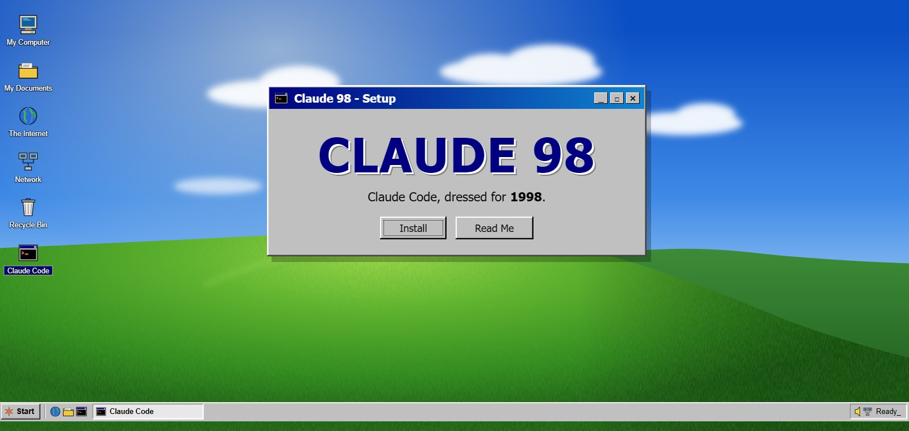

<p align="center">
  
</p>

<h1 align="center">🖥️ ClaudeXP</h1>

<p align="center">
  <strong>IT'S NOT A BUG, IT'S A FEATURE OF 2001! 💿</strong>
</p>

<p align="center">
  <a href="#-install"></a>
  
  
</p>

**ClaudeXP** is a mod that dresses Claude Code like an early-2000s desktop: a rolling green meadow behind the chat, desktop icons, a blue taskbar with a green `start` button and a blinking `Ready_`, rounded blue-framed windows with red close boxes, a start band above the prompt, a live **System Monitor** window and a proper **Display Properties** dialog.

Everything is drawn by the mod itself: original icons, an original meadow, no copied wallpapers.

Prefer the 1998 look? See its sibling, [Claude 98](https://github.com/weihaoc168/Claude98).

[Install](#-install) · [Features](#-features) · [Commands](#-commands) · [Display Properties](#-display-properties) · [FAQ](#-faq)

---

## ⚡ Install

At the prompt of a terminal session:

```
/plugin install claudexp --marketplace weihaoc168/ClaudeXP
```

From a shell:

```bash
claude plugin install claudexp --marketplace weihaoc168/ClaudeXP
```

In the desktop app: click **+** next to the prompt box → **Plugins** → **Add marketplace** with `weihaoc168/ClaudeXP` → **Add plugin**.

Answer `y` to add the marketplace and pick the **user** scope, and every new session boots into 2001.

## ✨ Features

| | |
| --- | --- |
| 🌄 **Meadow desktop** | A live scene behind the chat: sky, drifting clouds, hills and grass, under a light glass veil so your text stays readable. Zoom it from 100% to 50% to see the whole picture. |
| 🗂️ **Desktop icons** | My Computer, My Documents, The Internet, Network, Recycle Bin and Claude Code, pinned to the top-left at any window shape. |
| ▬ **Taskbar** | A glossy blue bar with a rounded green `start` button, quick-launch icons, a Claude Code task and a light-blue tray that blinks `Ready_`. |
| 🟢 **Start band** | A green `start` button, `System Monitor` and `Display` buttons right above the prompt. The Start menu opens every window. |
| 📊 **System Monitor** | A window beside the chat, cream with a blue frame and a red close box, counting each tool call, with usage bars, a scrolling call log and `[ok]` / `[!!]` results. Working **File / Edit / View** menus: clear the log, copy a summary, hide the bars or the log. |
| 🎨 **Color schemes** | Blue, Olive Green, Silver and Royale in light mode, and a shared "After Hours" scheme in dark mode. |
| 💾 **Remembers you** | Your wallpaper, scheme and effects are kept across sessions. |

## ⌨️ Commands

| Command | What it opens |
| --- | --- |
| `/display` | Display Properties |
| `/sysmon` | System Monitor |
| `/startmenu` | The Start menu |
| `/startband` | Shows or hides the Start band above the prompt |
| `/xp-check` | Which screens the session draws on, and whether the theme reached them |

## 🖼️ Display Properties

Three tabs, OK / Cancel / Apply, just like you remember:

- **Background**: Green Meadow, Teal, Navy, Olive, Black or Clouds, plus the meadow size.
- **Appearance**: the color scheme, with an Active Window preview.
- **Effects**: show or hide the desktop icons and the taskbar, whether System Monitor opens at startup, and whether the Start band shows above the prompt.

## ❓ FAQ

**The background is a solid color.** Your Claude app needs to be recent enough to draw mod backdrops. Update it, quit it fully (tray included) and start a new session.

**I can't see the icons.** They sit at the window's left edge, under the sidebar. Collapse the sidebar to see them.

**How do I remove it?** `claude plugin uninstall claudexp`.

---

<p align="center"><sub>Not affiliated with or endorsed by Microsoft. ClaudeXP is an original tribute; all art is drawn from scratch.</sub></p>
